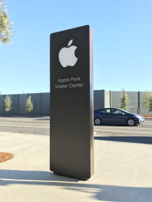

# Final pre-publication review

Updated: 2026-11-03 (Asia/Tokyo). Verification observations below were recorded
on 2026-11-02 UTC; this review refresh does not represent new test executions.

**The approved HEIC follow-up and independent verification are complete.** The
candidate uses `heic-decode` 2.1.0 with `libheif-js` 1.23.5 and the explicitly
approved newer pixel output. The owner explicitly accepted the confirmed-folder
chooser policy on 2026-11-03 after clarification. Merge and publication remain
unauthorized. The verified artifacts are review candidates.

## Candidate and scope

| Item | Selected candidate |
| --- | --- |
| Application version | `1.12.2-alpha`; no release-version bump is included. |
| Verified application source | [`79d547fa884658be9266f03ae3d20ea05899b34a`](https://github.com/TomoyukiAota/photo-location-map/commit/79d547fa884658be9266f03ae3d20ea05899b34a) |
| CI application head | `79d547fa884658be9266f03ae3d20ea05899b34a`; the [CI record](./evidence/HEIC_CI_CHECKPOINT.json) separately identifies each checked-out commit, including PR merge commits. |
| Approved HEIC selection | `heic-decode` 2.1.0; resolved `libheif-js` 1.23.5; old parent-scoped pin removed. Actual packaged metadata and selected decoder payload bytes are verified. |
| Review | [Draft PR #630](https://github.com/TomoyukiAota/photo-location-map/pull/630) |
| Framework | Angular core 22.2.4; CLI/Material 22.2.5; TypeScript 6.0.3. |
| Development runtime | Node 26.13.0 with its bundled npm 11.20.0, matching Photo Data Viewer. |
| Application runtime | Electron 45.2.1, embedded Node 24.22.1 and Chromium 156.0.8078.75. |
| Minimum macOS | 13, already accepted by the owner. |

The complete package inventory is in
[IMPLEMENTED_VERSIONS.json](./evidence/IMPLEMENTED_VERSIONS.json), with retained
versions explained in [EXCEPTIONS.md](./EXCEPTIONS.md). The approved decoder's
source chain, references and security limits are in
[HEIC_APPROVED_UPDATE.md](./evidence/HEIC_APPROVED_UPDATE.md). Each record
identifies its verified source and artifact identity. Earlier `f1f0ee5` reports
remain historical pre-follow-up evidence and do not verify this decoder.
Later documentation heads must not be substituted for the recorded application
source or checked-out CI commits.

The work preserves the app's existing architecture, controls and interactions,
with original screenshot references retained. The approved HEIC output change,
accepted chooser policy and time-zone corrections below remain material. The
optional experimental Dev-only Google Maps check lacks a valid key.

## Verification gates

All completed follow-up gates below use application source `79d547f`. Seven
workflows and eight actual platform test jobs pass without failures or reruns.
The CI record distinguishes branch heads from checked-out PR merge commits.

| Gate | Status | Evidence and limit |
| --- | --- | --- |
| Clean installation, runtime and local regression | **PASS** | [HEIC_MAC_CHECKPOINT.json](./evidence/HEIC_MAC_CHECKPOINT.json): complete graph, host/bundled-npm and Electron runtime checks, production build, lint, 194 unit tests and 15 checkout visual/functional cases. Original snapshots/tolerances remain unchanged. |
| Final universal Mac build and real notarization | **PASS** | [Mac identity and artifacts](./evidence/HEIC_MAC_CHECKPOINT.json): strict deep codesign, staple and Gatekeeper; original icon, macOS 13 minimum and both executable/framework architectures. Both extracted distributions match all 4,754 regular files plus symlink/directory entries of the signed bundle. Metadata and every ZIP/DMG blockmap chunk match. |
| Actual final packaged Mac app | **PASS** | 14 local visual/functional cases pass; the website-only case is skipped. Actual decoder 2.1.0/1.23.5, exact approved 300x400 pixel hash, corrupt-input behavior and embedded HEIC paths pass in the [Mac checkpoint](./evidence/HEIC_MAC_CHECKPOINT.json). |
| Final signed ZIP updater transport | **PASS** | [Mac checkpoint](./evidence/HEIC_MAC_CHECKPOINT.json): actual final ZIP download/cache/checksum handling; native setup is intercepted in this transport test. See the [harness limits](../../../test/updater/README.md). |
| Final DMG launch, smoke and cleanup | **PASS** | [Mac checkpoint](./evidence/HEIC_MAC_CHECKPOINT.json): mounted-DMG direct launch with a test-owned profile, main/renderer logs within the 60-second launch observation window, quit and detach. The app reports a 55-second session; this is not 60 seconds after readiness. |
| Isolated native updater fixture | **PASS** | [Mac checkpoint](./evidence/HEIC_MAC_CHECKPOINT.json): actual signed native install/relaunch/explicit downgrade rollback and settings through four starts. Separate test identity and candidate-runtime versions 99.0.1/99.0.2; this is not a public old-release or final-production-ZIP native installation. Exact caches/jobs/preferences are cleaned; the production bundle signature/fingerprint remains unchanged. |
| Windows installed NSIS application | **PASS** | [Both CI triggers](./evidence/HEIC_CI_CHECKPOINT.json): 194 units, install smoke and 14 packaged E2E cases per job. Actual push draft upload and [downloaded bytes](./evidence/HEIC_WINDOWS_DRAFT_BYTES.json) verified; PR-context uploading is skipped as intended. |
| Ubuntu created AppImage | **PASS** | [Both CI triggers](./evidence/HEIC_CI_CHECKPOINT.json): 194 units, AppImage smoke and 14 packaged E2E cases per job. Required-check name remains test (ubuntu-24.04); runner is 26.04. |
| macOS arm64 created universal app | **PASS** | [Push, PR and manual jobs](./evidence/HEIC_CI_CHECKPOINT.json): 194 units, universal smoke and 14 packaged E2E cases per job. |
| Native macOS Intel created universal app | **PASS** | [Manual run 41446524256, job 125280892676](./evidence/HEIC_CI_CHECKPOINT.json): same application head, 194 units, universal smoke and 14 packaged E2E cases. Native x64 runner/architecture assertions pass; local Rosetta is unavailable. |
| Experimental Dev-only Google Maps with a valid key | **OPTIONAL ADDITIONAL DEVELOPER COVERAGE — key unavailable** | Hidden in packaged Prod mode; see the owner-dependent item below. |
| Production public-feed upgrade and post-release downloads | **NOT RUN — publication not authorized** | Perform controlled post-publication checks after authorization; isolated transport/native fixtures do not prove this gate. |

CI tests actual created/installed applications. Its packaged runs are functional
checks with `PLM_VISUAL` disabled; they do not compare macOS pixel references.
The local signed/notarized Mac app has separate visual verification. Mac CI
package tests deliberately skip notarization. Passing decoder assertions do not
establish absence of security defects. Consult [STATUS.md](./STATUS.md) and the
[PR checks](https://github.com/TomoyukiAota/photo-location-map/pull/630/checks)
for any later documentation-head checks; do not infer success from a running or
superseded job.

### Verified artifact inventory

| Artifact/evidence | State |
| --- | --- |
| `Photo Location Map-1.12.2-alpha-universal.dmg` | [Current checksums, identity, signature and smoke](./evidence/HEIC_MAC_CHECKPOINT.json); no manual upload performed. |
| `Photo Location Map-1.12.2-alpha-universal-mac.zip` | [Current checksums, identity and transport](./evidence/HEIC_MAC_CHECKPOINT.json); no manual upload performed. |
| Windows installer/draft artifact | [Observed draft asset IDs/checksums/payload](./evidence/HEIC_WINDOWS_DRAFT_BYTES.json): all three GitHub digests, metadata and 6,641 blockmap chunks match. Actual decoder metadata and five selected payload files match the approved Mac build. The draft is unpublished and mutable; this dated observation is not a future release identity. |
| Linux AppImage | [Actual packaged CI results](./evidence/HEIC_CI_CHECKPOINT.json). No remote Linux artifact upload/download or persisted AppImage checksum is claimed. |
| Native fixture report and cleanup | [Passed; scope and exact cleanup](./evidence/HEIC_MAC_CHECKPOINT.json). |

Keep the verified production bundle unchanged. Any later runtime/source change
requires affected tests and artifacts to be rebuilt and reverified; an earlier
signature/checksum record does not transfer. A later Windows draft upload may
replace asset IDs and bytes, so recheck the actual assets before publication.

## Approved follow-up and remaining owner-dependent items

The approved HEIC implementation and independent verification are complete.
The HEIC output and confirmed-folder chooser choices are resolved and must not
be asked again. Merge/publication can be reviewed separately with the concrete
source/artifact evidence; neither compatibility choice authorizes release.

### 1. HEIC output and decoder security

**Output change approved and revalidated.** On 2026-11-02 the owner
selected the newer pixel output and authorized updating and revalidating it,
without authorizing publication. The current manifest uses `heic-decode` 2.1.0
and resolves `libheif-js` 1.23.5; the old parent-scoped override is removed.
Actual follow-up results and exact evidence are linked from
[HEIC_APPROVED_UPDATE.md](./evidence/HEIC_APPROVED_UPDATE.md).

The pre-follow-up `f1f0ee5` checkpoint preserved the original thumbnail pixels
with `heic-decode` 2.0.0 and pinned `libheif-js` 1.18.2. That historical pin was
not publication-approved. Its native source is in
the affected ranges of the heap-pixel disclosure and memory-corruption
advisories documented in [EXCEPTIONS.md](./EXCEPTIONS.md#decoder-security-review-2026-11-02).
A host escape against this exact WASM build was not established or tested.

The approved `heic-decode` 2.1.0 / `libheif-js` 1.23.5 selection includes the
reviewed fixes and changes the decoded pixels. In the earlier comparison, the
public 300×400 sample has a
mean absolute RGB-channel difference of approximately 0.135/255 and a maximum
of 12/255. This is one sample, not a bound over all HEIC files. Decoder isolation
and exact hashes are in
[HEIC_DECODER_COMPARISON.json](./evidence/HEIC_DECODER_COMPARISON.json).
The previews below come from that same public fixture; provenance is in the
[fixture README](../../../test/e2e/fixtures/README.md), and dimensions/pixel/file
hashes are in [DECODER_PREVIEWS.json](./evidence/DECODER_PREVIEWS.json).
These previews and comparison hashes preserve the decision's historical
evidence. Fresh worker assertions now match the separately approved reference
and actual shipped decoder versions; original references remain unchanged.

| Historical pixel-preserving decoder 1.18.2 | Approved decoder 1.23.5 comparison |
| --- | --- |
|  |  |

The owner accepted the measured output difference, and implementation,
regression checks and fresh packaging are complete. This approval and the
passing tests do not establish that 1.23.5 is security-clean: the latest npm
codec still predates native 1.23.7's
HEVC CPU-exhaustion fix, and current per-file worker restarts impose no decode
timeout. The remaining defect stays disclosed for the later publication decision.
Holding publication while awaiting a suitable upstream fix remains an option;
no unsupported decoder fork or unreviewed timeout policy is included.

The signed artifacts recorded for `f1f0ee5` remain the historical
pixel-preserving checkpoint. The current `79d547f` records identify newly
verified and signed artifacts with the approved decoder; the old records must
not be relabeled as evidence for those bytes.

### 2. Native folder-chooser history

**Accepted on 2026-11-03.** After clarification, the owner explicitly selected
the confirmed-folder policy and accepted its starting-location differences.
The earlier clarification question alone was not approval. This subsequent
choice resolves the policy decision, without authorizing merge/publication or
claiming exact native MRU restoration.

The original app let the OS choose the picker's starting location, typically
its last **viewed or navigated** directory. The adapter instead requests the
last **folder itself confirmed in this picker**, saved across app restarts.
CLI and drag-and-drop loads do not update that value. This does not delete OS
history or photo files, reset existing settings, or introduce automatic
photo restoration at startup.

Examples of the policy difference include:

- On first upgrade, the new history value is absent. The picker normally starts
  in Downloads/Home until the user confirms a folder once.
- After confirming A, navigating to B and canceling leaves A as the next
  requested location; Electron does not return B on cancellation.
- Selecting child A while viewing parent P can also differ from the old native
  viewed-location history. The adapter records A; the old OS/backend result is
  not guaranteed to equal A. First-upgrade and cancellation are examples, not
  the complete set of differences.

There is no reliable exact cross-platform migration API. macOS's documented
`NSNavRecentPlaces` read could support a best-effort policy, but its ordering
does not guarantee the last picker/cancel location. Linux portal backends below
version 4 can ignore `defaultPath`, so actual native behavior depends on the
backend. The E2E checks a stubbed dialog's options, real storage and restart;
it does not establish the actual native panel's MRU behavior.

**Selected policy:** retain the confirmed-folder implementation as explicitly
accepted by the owner. No preference heuristic, custom native dialog
or Electron fork is included.
See [NATIVE_CHOOSER_COMPATIBILITY.md](./evidence/NATIVE_CHOOSER_COMPATIBILITY.md)
for the original behavior change, adapter contract and verification scope.

### 3. Google Maps credentials or owner-run confirmation

The Google Maps menu is explicitly experimental and visible only in Dev mode;
the normal packaged Prod application does not expose it. The task environment
has no usable Google Maps API key, so this additional key-backed developer
coverage has not been verified. It is not an unverified packaged-Prod feature
or an automatic publication blocker. If this coverage is desired,
owner-dependent input is a valid test key in a
secure local test configuration. The agent should then perform the remaining
verification. If that access cannot be provided, record an owner-run check of
the existing Google Maps mode and its exact result instead. Do not place a key
in this public decision record. Other independent checks must finish first.

### 4. Merge and public release

Merge/public release remains a separate authorization gate under
[PLAN.md](./PLAN.md) and [CLAUDE.md](../../../CLAUDE.md). A later concrete
publication request must identify the final source, artifact checksums and
release/tag treatment, including the existing prerelease updater guard. No
stable-version bump is inferred from this implementation.

The existing v1.12.2-alpha draft is still unpublished and has prerelease=false;
review that channel/tag treatment explicitly before any publication. The
Windows workflow's deliberate draft uploads are already authorized and are
not a new approval item. Angular 22, macOS 13+, the matching Node/bundled-npm
pair and implementation with Sol are settled choices, not questions to reopen.

## Disclosed changes and residual risks

Time-zone data changes from 2022g to 2026f correct converted date/time values
without changing application formatting or selection algorithms. In the 12
recorded samples, Almaty changes from UTC+6 to UTC+5 and Cairo from UTC+2 to
UTC+3 for the sampled July 2026 instant. This is not an exhaustive list of
affected regions/dates. Include this correction in the final change summary;
do not claim every displayed date/time remains numerically identical. See
[TIMEZONE_CHANGES.json](./evidence/TIMEZONE_CHANGES.json).

The refreshed clean npm graph reports 75 propagated advisory entries across
five leaf packages: 30 high, 44 moderate and one low. Supported parent ranges
have no remaining compatible fix identified. Parent constraints and investigated
runtime reachability are recorded in
[AUDIT_DISPOSITION.json](./evidence/AUDIT_DISPOSITION.json). Its zero npm-critical
count does not describe the separate native codec advisories or prove an
absence of exploitable defects. These findings accompany the publication
decision; they are not 75 separate owner approvals. The audit record identifies
the approved decoder's current lockfile hash and the removed historical pin.

## Resume and completion rule

1. Reconcile the actual app source, workflow head and artifact identities with
   this record and STATUS before continuing. Classify failures before reruns.
2. The approved `heic-decode` 2.1.0 / `libheif-js` 1.23.5 follow-up is verified
   at `79d547f`. Do not repeat the approved output question or redo completed
   gates without a new change or unresolved concern. Any later application
   change requires fresh affected tests and artifact identities.
3. The confirmed-folder chooser policy was explicitly accepted on 2026-11-03
   after clarification; do not reopen it. Optional Dev-only credentials remain
   separate from packaged-Prod validation. Independent work and implementation
   compatibility decisions are complete.
4. Keep merge and publication pending; the HEIC implementation approval does
   not authorize them; neither does chooser acceptance. After explicit
   publication authorization, complete the
   public-download/feed checks and record their actual results and limits.
